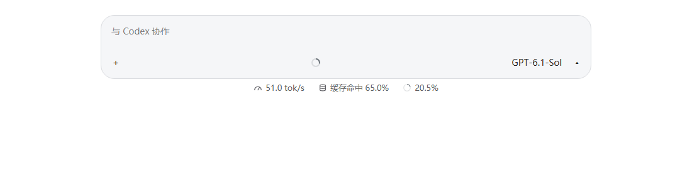

# Native Codex composer usage discovery

Remote AI's native Codex statusline reads cached-input and context metrics from the selected local
conversation's original `tokenUsageInfo` subscription. Output speed uses independent proxy timings.
Missing native usage therefore used to leave cache/context metrics blank while speed still worked.

Codex Windows package `26.1029.7803.0` uses numbered Rspack ESM entry files rather than the former
`app-shared-*.js` module preload. The old loader could not discover the subscription service, and the
legacy React registry fallback could not find the replacement manager.

Discovery now supports both layouts:

- Preserve the old same-origin `app-shared-*.js` preload entry.
- Inspect existing same-origin module-script entries under `/assets/` for an exported
  `__webpack_require__` runtime and its initialized module cache.
- Find the original `appServerManagers` service in cached exports. Do not invoke `require`, evaluate
  module factories, import classic scripts, open accounts, resume threads, or synthesize Token counts.
- Skip callable RPC proxies, unavailable/throwing exports and failed modules. Limit imported entries
  to eight and cached modules to 20,000, yielding every 200 modules to keep the composer responsive.
- Share overlapping discovery, then re-read the live cache on later subscription attempts. Existing
  selected-thread, disconnection, disposal and stale-callback protections remain unchanged.

Statusline version 11 replaces the previous injected version through the existing renderer lifecycle.
This discovery code is specific to overlays in the native Codex application. Remote AI's own desktop,
remote and web conversations continue using their existing application usage adapters and shared
calculations; their data contracts and appearance are unchanged.

## Verification

Run from the repository root:

```sh
node --test scripts/codex-native-usage-service.test.mjs scripts/codex-native-usage-subscription.test.mjs scripts/codex-usage-statusline.test.mjs scripts/codex-usage-metrics.test.mjs scripts/codex-usage-statusline.browser.test.mjs
```

The browser suite uses bundled Chromium and exercises legacy preloads and numbered Rspack entries,
actual service discovery and subscription delivery, conversation switching, pending timings, typing,
narrow windows, light/dark appearances and existing localization. Desktop's normal `check` also runs
the service-discovery and subscription unit tests.

The fixture below uses simulated usage (65% cached input, 20.5% context) and contains no live account
or conversation data:



Live Windows validation also restored both percentages using the original native service without a
new conversation request. That renderer-only validation is temporary until an updated Remote AI
build is installed. macOS live application validation was not performed locally.
