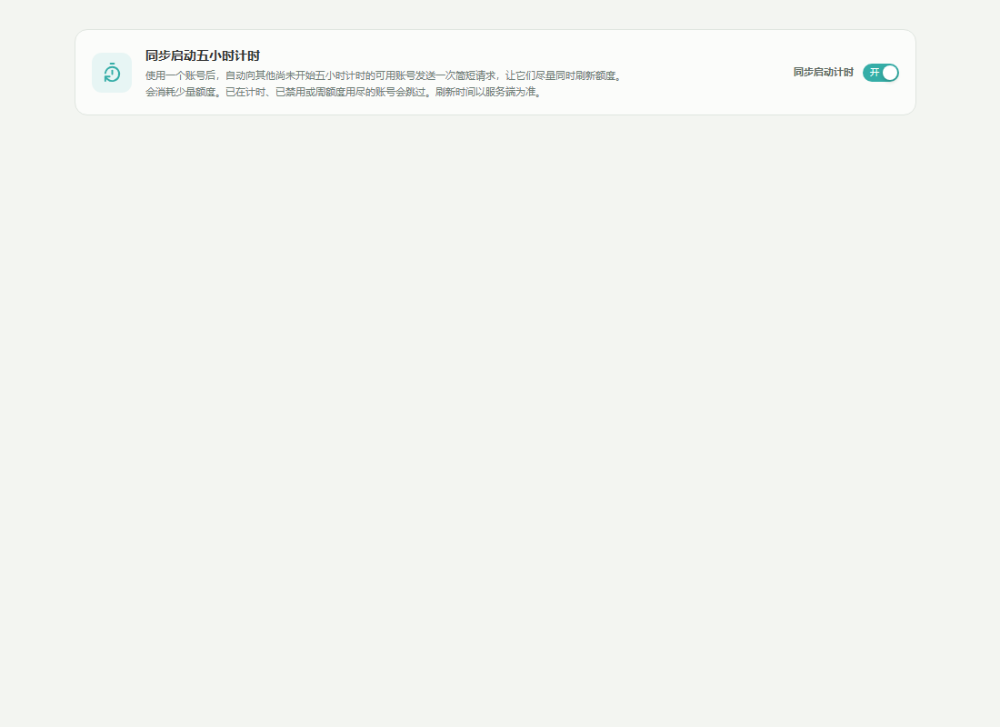
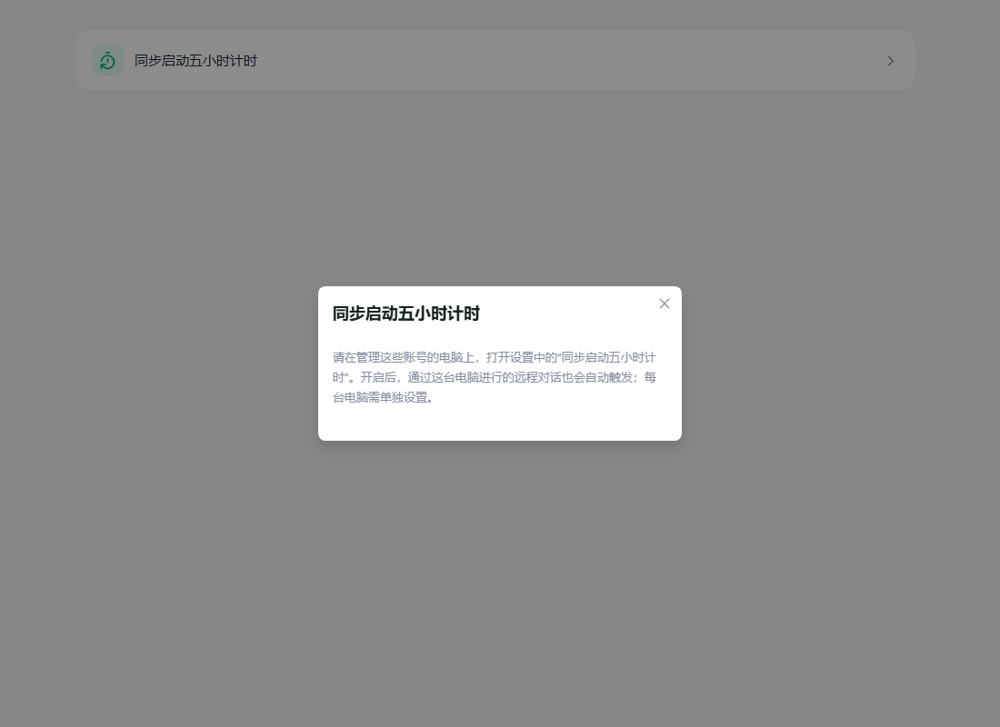

# Start five-hour account windows together

Enable **Settings → Start five-hour windows together → Start windows together** on the
computer managing the accounts. The preference defaults to off and is local to each computer.
The same switch is available through that computer's hosted web interface. Independent cloud
Web settings explain where to enable it; the cloud service does not hold the computer's preference.

After a real official-account request produces tokens, Remote AI checks other enabled managed
accounts in the background. Remote conversations routed through the computer use the same path.
For direct clients, a successful quota refresh also detects increased usage or a newly started
five-hour window. Initial imports and unchanged quota refreshes do not trigger synchronization.
Direct-client detection therefore follows the existing quota-refresh cadence.

An account is activated only after a fresh successful quota read confirms a 300-minute window
with zero usage, full remaining allowance, and no future reset timestamp. A future reset means
the account is already counting down, including when its reported usage rounds to zero. Unknown
or invalid quota, disabled or expired accounts, and accounts with exhausted unexpired weekly
allowances are skipped. Five-hour windows may be reported as either primary or secondary.

Activation reuses the existing short quota-consumption request and credential refresh handling.
It spends a small amount of allowance. Up to four accounts are processed concurrently, with one
background sweep at a time and a 30-second interval between sweeps. Ordinary conversation
responses do not wait for this work. The background sweep refreshes account usage after each
activation attempt so displayed reset times always come from the service. The service owns
the windows; exact alignment is not guaranteed.

Before sending, Remote AI writes `quota-window-sync.json` in the account's local directory.
The marker prevents another automatic attempt for five hours, including after a restart or
an ambiguous network/stream failure. This deliberately favors avoiding repeated charges:
a failed attempt may leave an account unsynchronized until the marker expires. Manual quota
consumption remains available. Synthetic requests do not pass through normal proxy accounting,
and quota refreshes within a running sweep cannot recursively create another sweep.

The dedicated preference setter serializes changes and ordinary stale settings writes preserve
the latest saved value. Turning the feature off stops subsequent activation attempts; requests
already sent may still finish.

## Verification

- Rust tests cover idle/running/rounded-zero windows, unknown quota, weekly exhaustion,
  direct-client detection, single-flight throttling, persisted attempt markers, and settings defaults.
- A settings-storage regression test covers stale writes and disabling the feature.
- `npx playwright test --config playwright.quota-window-sync.config.ts` from `apps/desktop`
  checks local IPC and hosted HTTP transports, persistence, load/save errors, cloud Web guidance,
  and all four released languages. These fixtures mock account-service responses and spend no quota.
- Run the desktop TypeScript/Vite build, Web type check/build, i18n generation/check, Rust formatting,
  relevant native tests, and Clippy before shipping.

Live service verification requires test accounts with an idle five-hour window. Confirm that using
one account activates only the eligible others and that the service subsequently reports their
reset times. Browser fixtures and unit tests cannot establish the provider's live quota semantics.

## Interface screenshots

Captured from the running browser fixtures at a 1100 × 800 desktop viewport, using the real UI
components and mocked backend responses. These screenshots do not represent live quota consumption.

Desktop local settings, enabled:

Independent cloud Web settings, per-computer setup guidance:

