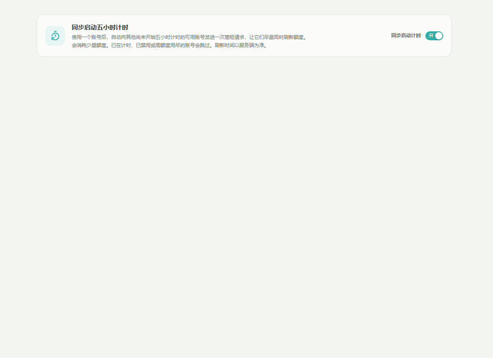
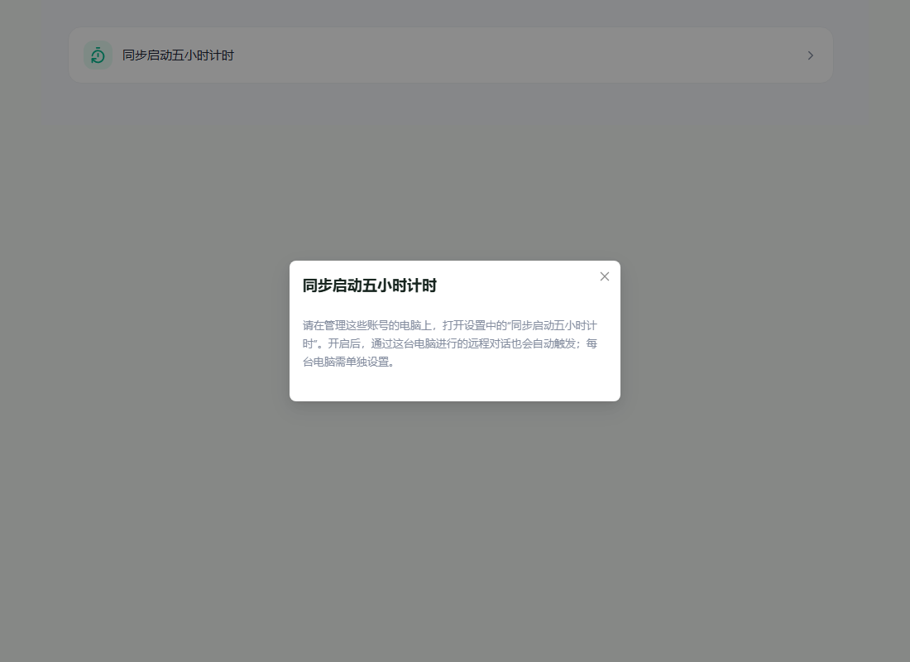

# Start five-hour account windows together

Enable **Settings → Start five-hour windows together → Start windows together** on the
computer managing the accounts. The preference defaults to off and is local to each computer.
The same switch is available through that computer's hosted web interface. Independent cloud
Web settings explain where to enable it; the cloud service does not hold the computer's preference.

After a real official-account request produces tokens, Remote AI checks other enabled managed
accounts in the background. Remote conversations routed through the computer use the same path.
For direct clients, a successful quota refresh also detects increased usage or a newly started
five-hour window. Initial imports and unchanged quota refreshes do not trigger synchronization.
Direct-client detection therefore follows the existing quota-refresh cadence.

An account is activated only after fresh successful quota reads confirm an idle 300-minute
window with zero usage and full remaining allowance. A missing or expired reset can be checked
with one read. An unused account can also report a future reset near the query time plus five
hours: that deadline moves forward whenever usage is refreshed, so it is not evidence that the
window has started. For these ambiguous windows, the worker waits at least three seconds and
queries again. It activates the account only if the reset advances with the query time. A fixed
future deadline is skipped even when reported usage rounds to zero. Failed or inconclusive
confirmation reads do not authorize consumption. Unknown or invalid quota, disabled or expired
accounts, and exhausted unexpired weekly allowances are also skipped. Five-hour windows may be
reported as either primary or secondary.

Refreshing a moving idle deadline does not count as account activity and cannot trigger another
sweep. A newly fixed rounded-zero deadline can be detected through successive quota reads; proxy
requests also trigger directly from token usage. Enabling the setting alone does not start a sweep.

Activation reuses the existing short quota-consumption request and credential refresh handling.
It spends a small amount of allowance. Up to four accounts are processed concurrently, with one
background sweep at a time and a 30-second interval between sweeps. Ordinary conversation
responses do not wait for this work. The background sweep refreshes account usage after each
activation attempt so displayed reset times always come from the service. The service owns
the windows; exact alignment is not guaranteed.

Before sending, Remote AI writes `quota-window-sync.json` in the account's local directory.
The marker prevents another automatic attempt for five hours, including after a restart or
an ambiguous network/stream failure. This deliberately favors avoiding repeated charges:
a failed attempt may leave an account unsynchronized until the marker expires. Manual quota
consumption remains available. Synthetic requests do not pass through normal proxy accounting,
and quota refreshes within a running sweep cannot recursively create another sweep.

The dedicated preference setter serializes changes and ordinary stale settings writes preserve
the latest saved value. Turning the feature off stops subsequent activation attempts; requests
already sent may still finish.

## Verification

- Rust tests cover moving idle deadlines, fixed rounded-zero deadlines, sequential confirmation
  queries, errors and new usage between queries, unknown quota, weekly exhaustion, direct-client
  detection, single-flight throttling, persisted attempt markers, and settings defaults. Probe tests
  pass service-shaped responses through the actual quota parser before exercising the worker.
- A settings-storage regression test covers stale writes and disabling the feature.
- `npx playwright test --config scripts/playwright.quota-window-sync.config.ts` from `apps/desktop`
  checks local IPC and hosted HTTP transports, persistence, load/save errors, cloud Web guidance,
  and all four released languages. These fixtures mock account-service responses and spend no quota.
- Run the desktop TypeScript/Vite build, Web type check/build, i18n generation/check, Rust formatting,
  relevant native tests, and Clippy before shipping.

Live service verification requires test accounts with an idle five-hour window. Confirm that using
one account activates only the eligible others and that the service subsequently reports their
reset times. Browser fixtures and unit tests cannot establish the provider's live quota semantics.

To diagnose activation, compare the absolute reset time across multiple quota refreshes. A full
five-hour countdown that restarts on every refresh is an idle placeholder; a running window keeps
its absolute deadline while the countdown decreases. A remaining display of 100% alone cannot
distinguish the two. User screenshots exposed the moving-reset case that the original tests missed.

## Interface screenshots

Captured from the running browser fixtures at a 1100 × 800 desktop viewport, using the real UI
components and mocked backend responses. These screenshots do not represent live quota consumption.

Desktop local settings, enabled:

Independent cloud Web settings, per-computer setup guidance:

